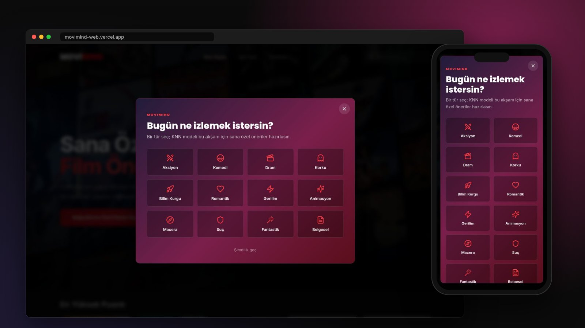
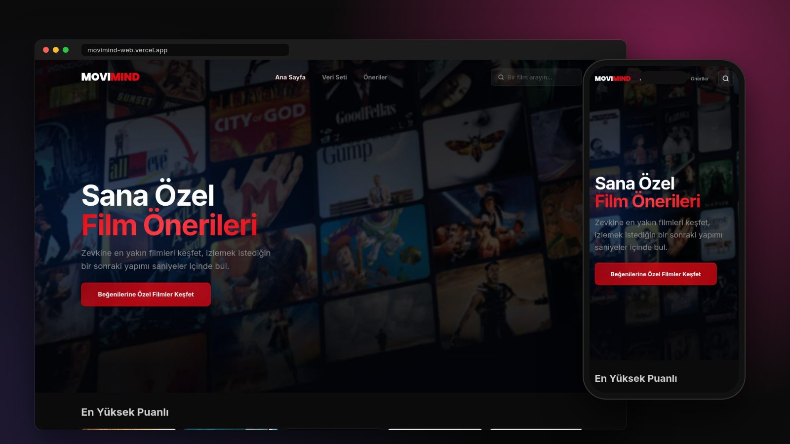
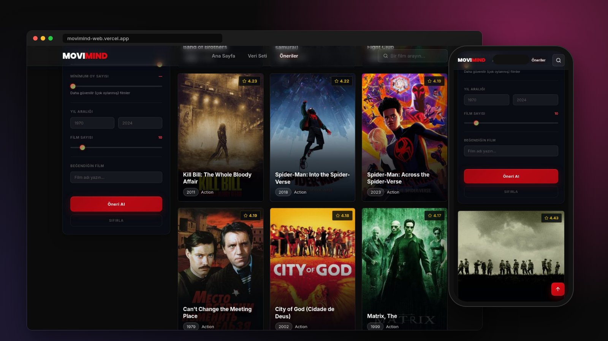
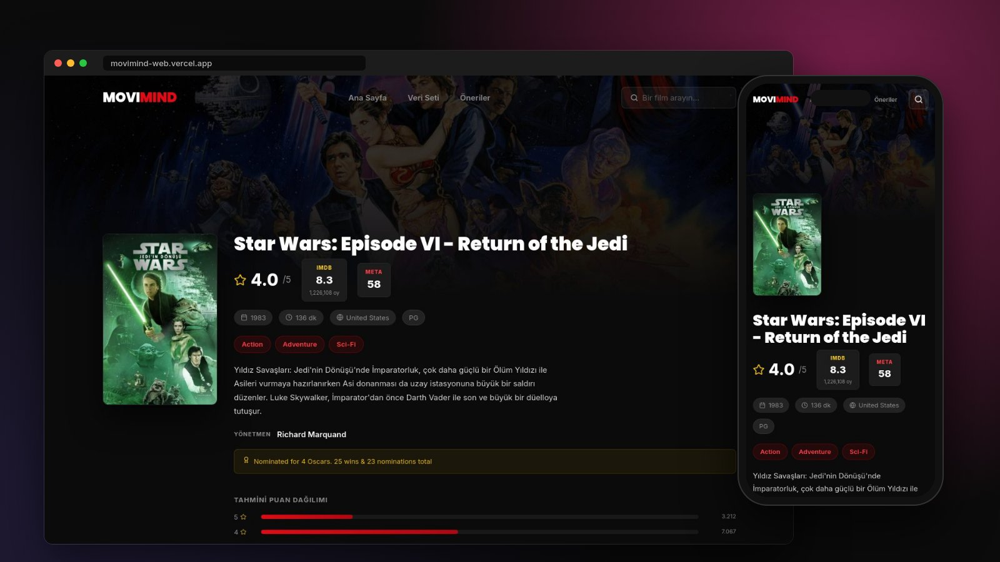
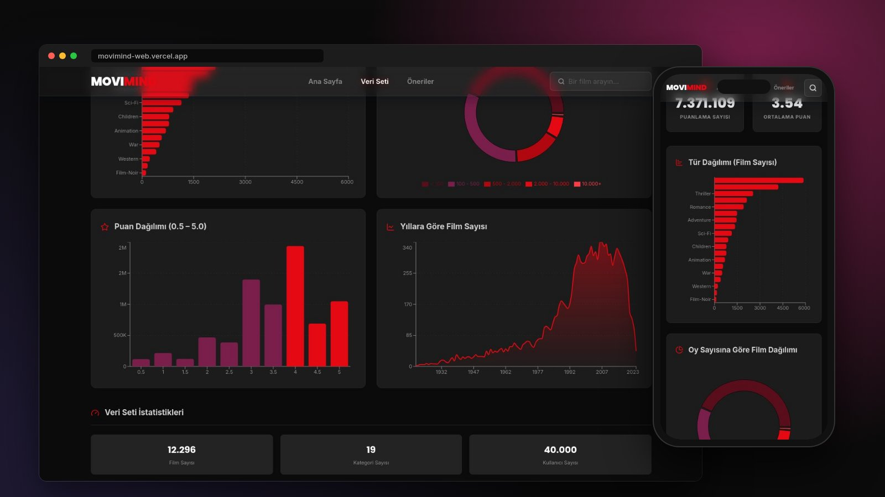
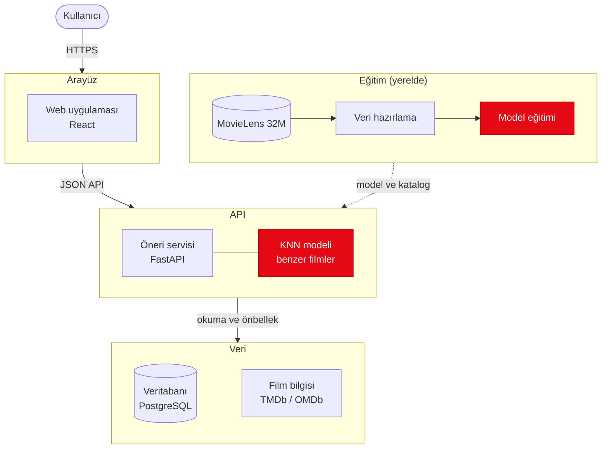

# MOVIMIND

> MovieLens 32M veri seti üzerinde çalışan, kişiselleştirilmiş film öneri platformu.


## Özet

MOVIMIND, MovieLens 32M veri seti üzerinde eğitilen bir KNN modeliyle kullanıcının zevkine yakın filmleri öneren bir web uygulamasıdır. Makine öğrenmesi hattı (veri temizleme, eğitim, değerlendirme) ile modern bir web arayüzünü bir araya getirir. MOVIMIND film yayını yapmaz; öneri, film bilgisi ve resmi fragman sunar.

## Ekran Görüntüleri


**Bugün ne izlemek istersin?**




**Ana sayfa**




**Kişiselleştirilmiş öneriler**




**Film detayı**




**Veri seti analizi**




## Öne Çıkan Özellikler

* **Canlı KNN önerileri:** Her film, onu puanlayan kullanıcıların puanlarından oluşan bir vektördür (item-based collaborative filtering). Puanlardan kullanıcının ortalaması çıkarılır; böylece Öklid mesafesi cömert ya da cimri puanlama eğilimini değil, tercih biçimini ölçer. Eğitilmiş model her öneri isteğinde canlı çalışır.
* **Kriterli öneri:** Tür, puan aralığı, yıl, minimum oy sayısı ve etikete göre filtreleme; beğenilen bir filme göre benzer yapımlar.
* **Veri seti analizi:** Tür, puan, yıl ve popülerlik dağılımları ile modelin doğruluk metrikleri ayrı bir sayfada.
* **Zengin film detayı:** Oyuncu kadrosu, yönetmen, IMDb puanı ve fragman TMDb ve OMDb'den alınır; sonuçlar 30 gün önbellekte tutulur.
* **Tek komutla otomasyon:** `python main.py` gerekirse veriyi temizler, modeli eğitir, veritabanına yayınlar ve API'yi başlatır.
* **Güvenli anahtar yönetimi:** API anahtarları yalnızca server'dadır. Tarayıcı yalnızca kendi API'mize ve TMDb'nin görsel sunucusuna bağlanır.

## Sistem Mimarisi



* **Eğitim yerelde yapılır.** Ham veri temizlenir, KNN modeli eğitilir ve örneklem üzerinde değerlendirilir. Model dosyası GitHub Releases'e, katalog ve analiz verisi Neon'a yazılır.
* **Canlı server** model dosyasını olduğu gibi yükler ve her öneri isteğinde `kneighbors` çalıştırır. Ham veri canlı ortamda bulunmaz.
* **Veritabanı** yalnızca fonksiyon ve prosedürlerle kullanılır; şema `database/` altındaki sürümlü script'lerdedir.

| Tablo | İçerik |
|---|---|
| `movies` | Film kataloğu: başlık, tür, yıl, etiketler, ortalama puan, oy sayısı, poster |
| `app_meta` | Veri Seti sayfasının grafikleri, istatistikler ve model metrikleri |
| `external_cache` | TMDb ve OMDb'den alınan film detayları (30 günde bir yenilenir) |

## Model

| | |
|---|---|
| Algoritma | KNN (`NearestNeighbors`, brute force), Öklid mesafesi, K = 10 |
| Özellik vektörü | Film × kullanıcı matrisi, kullanıcı ortalaması çıkarılmış puanlar |
| RMSE / MAE | 0,657 / 0,423 |
| Precision (4+ puan) | 0,936 |

Metrikler, rastgele seçilen 1.500 kullanıcının birer puanı modelden saklanıp tahmin edilerek hesaplanır.

## Veri Seti

GroupLens Research (University of Minnesota) tarafından yayımlanan [MovieLens 32M](https://grouplens.org/datasets/movielens/32m/), 9 Ocak 1995 – 12 Ekim 2023 arasında verilmiş puanları içerir. Az oy alan filmler (75'ten az) ve az puan veren kullanıcılar (30'dan az) elendikten sonra 40.000 kullanıcılık bir örneklem kullanılır:

| | Ham veri seti | Modelde kullanılan |
|---|---:|---:|
| Puan | 32.000.204 | 7.371.109 |
| Kullanıcı | 200.948 | 40.000 |
| Film | 87.585 | 12.296 |

### Atıf

> F. Maxwell Harper and Joseph A. Konstan. 2015. The MovieLens Datasets: History and Context. ACM Transactions on Interactive Intelligent Systems (TiiS) 5, 4: 19:1–19:19. <https://doi.org/10.1145/2827872>

**Kullanım koşulları:** Veri seti ticari olmayan amaçla kullanılmaktadır. MOVIMIND, University of Minnesota veya GroupLens Research tarafından onaylanmış ya da desteklenmiş değildir. Ayrıntılar veri setiyle gelen `README.txt` dosyasının *Usage License* bölümündedir.

## Proje Yapısı

```text
movimind/
├── client/                 # React, TypeScript, Sass ve Vite ile arayüz
│   ├── src/features/       # Sayfalar: home, recommend, dataset, movie, category
│   ├── src/components/     # Paylaşılan bileşenler
│   ├── src/services/       # API istemcisi (tek bağlantı noktası)
│   └── Dockerfile          # Yerel çalıştırma için arayüz imajı
├── server/                 # Python ve FastAPI ile API
│   ├── app/api/            # Endpoint'ler
│   ├── app/data/           # Veri temizleme ve analiz
│   ├── app/model/          # Eğitim, değerlendirme, yayın ve öneri motoru
│   ├── app/db/             # Veritabanı erişim katmanı
│   └── Dockerfile          # API imajı (yerel ve canlı)
├── database/               # Sürümlü PostgreSQL script'leri (tablo, prosedür, fonksiyon, trigger)
├── .github/workflows/      # CI ve deploy
├── docker-compose.yml      # Yerelde iki katmanı birlikte başlatır
├── CITATION.cff            # Proje ve veri seti atıf bilgisi
└── LICENSE
```

## Kurulum ve Çalıştırma

Gereksinimler: Python 3.13, Node.js 22, bir [Neon](https://neon.com) veritabanı. TMDb ve OMDb anahtarları isteğe bağlıdır; boş bırakılırsa oyuncu, IMDb puanı ve fragman gösterilmez.

### 1. Ortam değişkenleri

Örnek dosyaları kopyalayıp kendi değerlerinizi girin. Gerçek `.env` dosyaları depoya girmez.

```bash
cp server/.env.example server/.env   # DATABASE_URL, TMDB_API_KEY, OMDB_API_KEY ...
cp client/.env.example client/.env   # VITE_API_BASE
```

### 2. Veri seti

[MovieLens 32M](https://grouplens.org/datasets/movielens/32m/) arşivini indirip içeriğini `server/data/raw/ml-32m/` klasörüne çıkarın. Ham veri lisans koşulları ve boyutu nedeniyle depoda bulunmaz.

### 3. API

```bash
cd server
pip install -r requirements.txt
python main.py
```

İlk açılışta veri temizleme, model eğitimi ve veritabanına yayın otomatik çalışır. Sonraki açılışlarda yalnızca model değiştiyse yeniden yayın yapılır. API belgeleri: [http://localhost:8000/docs](http://localhost:8000/docs).

### 4. Arayüz

```bash
cd client
npm install
npm run dev
```

Arayüz [http://localhost:5173](http://localhost:5173) adresinde açılır.

### Docker ile

Python veya Node kurmadan iki katmanı birlikte başlatmak için (`server/.env` gerekli):

```bash
docker compose up --build
```

Arayüz [http://localhost:5173](http://localhost:5173), API [http://localhost:8000/docs](http://localhost:8000/docs) adresinde açılır. Veri seti ve model klasörleri bilgisayardan bağlanır.

## Canlı Ortam

| Katman | Platform | Dağıtım |
|---|---|---|
| Arayüz | Vercel | GitHub Actions build çıktısını yükler |
| API | Render (Docker) | GitHub Actions imajı GitHub Container Registry'ye gönderir, Render bu imajı çalıştırır |
| Veritabanı | Neon (PostgreSQL) | Katalog ve analiz verisi; şema `database/` script'leriyle |
| Model | GitHub Releases | `knn_model.pkl`, `model-*` etiketli sürümlerde; imaj en son sürümü kullanır |

## Üçüncü Taraf Veri Kaynakları

- Film detayları, posterler ve fragmanlar [TMDB](https://www.themoviedb.org/) API'sinden alınır. *This product uses the TMDB API but is not endorsed or certified by TMDB.*
- IMDb puanı, ödüller ve ek bilgiler [OMDb API](https://www.omdbapi.com/)'den alınır.

## Lisans

Kaynak kod [MIT](LICENSE) lisanslıdır. MovieLens verisi ile TMDb ve OMDb'den alınan veriler kendi lisans koşullarına tabidir.
